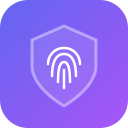
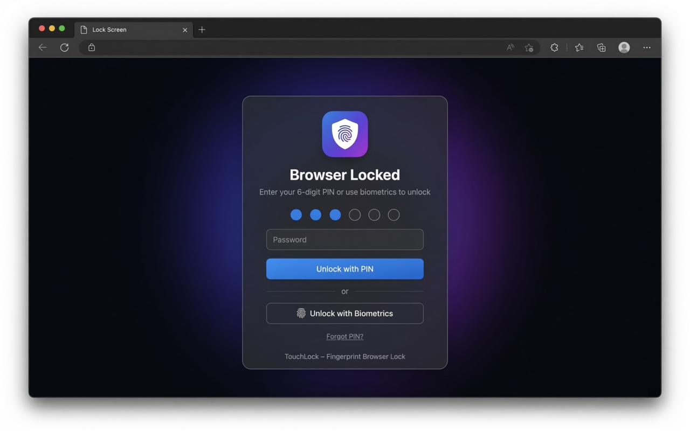

# TouchLock

**Lock your browser — or just your bank and email sites — with Touch ID, Windows Hello, or a PIN.**

[Chrome Web Store](https://chromewebstore.google.com/detail/jajgeiifpgdfnphjklcogipefkfdacdl) ·
[Edge Add-ons](https://microsoftedge.microsoft.com/addons/detail/aibbojojoeamjgikgailflpbhdpcjgln) ·
[Firefox Add-ons](https://addons.mozilla.org/en-US/firefox/addon/touchlock-fingerprint-lock/) ·
[Website](https://touchlock.vercel.app) ·
[Changelog](https://touchlock.vercel.app/changelog.html)

## Why TouchLock

Shared computers, open laptops, curious coworkers. TouchLock puts a real lock screen in front of your browser profile — tabs, history, downloads, bookmarks — and can keep individual sites locked even while the rest of the browser is open. It's free, open source, and everything stays on your device.

## Features

**Lock your browser**
- Locks every tab and window behind a full-screen lock screen
- Locks automatically on startup and, optionally, after 1 minute to 1 hour of inactivity
- Lock instantly from the toolbar or with <kbd>Alt</kbd>+<kbd>L</kbd> (customizable; <kbd>Ctrl</kbd>+<kbd>L</kbd> on Mac)
- Optional fullscreen mode hides the address bar and tabs while locked
- Nothing opens while locked: websites and browser pages are held at the lock screen until you unlock

**Lock specific sites** PRO
- Keep sites like your bank or email locked even after unlocking the browser
- Add sites in Settings, or click **Lock this site** in the toolbar popup
- Choose when a site locks again: when you leave it (default), after 5–60 minutes, or when the browser locks
- Optionally include subdomains — locking `google.com` also covers `mail.google.com`

**Unlock your way**
- Touch ID on macOS or Windows Hello on Windows, triggered automatically
- A 4–10 digit PIN, always available as a fallback
- Optionally require your PIN every 1–24 hours, even when you use your fingerprint PRO

**Stay in control**
- Changing your PIN, biometrics, recovery questions, or locked sites requires your PIN or fingerprint
- Forgot your PIN? Answer 2 of your 3 security questions to reset it
- A guided tour walks you through every setting on first install

## Getting Started

1. **Install** TouchLock from your browser's store (links above). Settings opens automatically.
2. **Set a PIN** (4–10 digits).
3. **Add 3 security questions** so you can reset a forgotten PIN.
4. **Register biometrics** *(recommended)* — Touch ID or Windows Hello.
5. *(Optional)* **Lock specific sites** in **Settings → Lock Specific Sites**.

That's it — your browser locks the next time it starts.

## Browser Support

| Browser | Supported |
|---|---|
| Google Chrome, Microsoft Edge, Brave | 110 or later |
| Opera, Vivaldi, other Chromium browsers | Should work (110 or later) |
| Firefox | 115 or later · biometric unlock needs 150 or later |

## Privacy & Security

- **Local only.** Your PIN, biometrics, settings, and locked sites never leave your device.
- **Hashed, never plain text.** The PIN and security answers are hashed with SHA-256 and a random salt.
- **On-device biometrics.** WebAuthn platform authenticators with user verification required; fingerprints never reach TouchLock.
- **No tracking.** No accounts, analytics, or ads.
- **Auditable.** Plain JavaScript, no third-party libraries.

> **Limitation:** someone with access to an unlocked browser can still disable or remove the extension from the browser's extensions page.

## Permissions

| Permission | Used for |
|---|---|
| `storage` | Saving your hashed PIN, security questions, settings, and locked sites |
| `tabs` | Showing the lock screen in every window and guarding tabs while locked |
| `scripting` | Covering pages that loaded before TouchLock started |
| `idle` | Locking after a period of inactivity |
| `alarms` | Re-locking a site after the minutes you chose |
| `declarativeNetRequestWithHostAccess` | Sending locked sites to the unlock page before they load |
| `<all_urls>` host access | The lock overlay and site-lock redirects on any page |

## Feedback

Every bug report and feature request is fixed or built within 7 days. Follow progress on the [feedback tracker](https://touchlock.vercel.app/feedback.html), use **Request a Feature** in Settings, or [open an issue](https://github.com/mathinraj/TouchLock/issues).

## Development

To run TouchLock from source:

1. Clone the repository.
2. Open your browser's extensions page and turn on **Developer mode**:
   - Chrome / Edge / Brave: `chrome://extensions`, `edge://extensions`, `brave://extensions` → **Load unpacked** → select the repository root.
   - Firefox: `about:debugging#/runtime/this-firefox` → **Load Temporary Add-on** → select `firefox/manifest.json`.

<strong>Version history</strong>

Full release notes: [touchlock.vercel.app/changelog.html](https://touchlock.vercel.app/changelog.html) · [GitHub Releases](https://github.com/mathinraj/TouchLock/releases)

**v1.5.1**
- Stricter lock: while locked, websites and browser pages are sent to the lock screen before they open, and return after unlock
- Esc no longer exits the fullscreen lock; closing the browser while locked keeps it locked on restart

**v1.5.0**
- Require PIN every 1, 4, 6, 12, or 24 hours: after that, biometrics stop working until you unlock once with your PIN

**v1.4.1**
- Fixed the browser staying in fullscreen after unlocking; fullscreen lock is now off by default
- Fixed biometric registration in Firefox ("The operation is insecure"); requires Firefox 150+
- Clearer message when Firefox blocks registration because website access is off

**v1.4.0**
- Lock Specific Sites, with re-lock timing, subdomain, and browser-unlock options
- PIN or fingerprint required for sensitive settings changes and Reset All
- Cleaner popup with a current-site card and Settings gear icon
- Feedback tracker, 7-day fix promise, and optional email follow-up
- Firefox minimum version raised to 115

**v1.3.6**
- Fixed the missing logo in store builds

**v1.3.5**
- Guided tour, fullscreen lock screen, and auto-saving lock settings
- Redesigned settings page with sidebar navigation, setup progress, and grid / list views

**v1.2.1**
- Store-specific builds, update notifications, rating prompt, and uninstall feedback page

**v1.2.0**
- 4–10 digit PINs with a strength indicator
- Customizable lock shortcut (Alt+L), auto-applied in Firefox

**v1.1.0**
- First public release: biometric unlock, PIN, security questions, auto-lock, and tab guards

---

Made by [Mathinraj](https://mathinraj.is-a.dev/) · If TouchLock helps you, [buy me a coffee](https://coindrop.to/mathinraj) or leave a review ⭐

